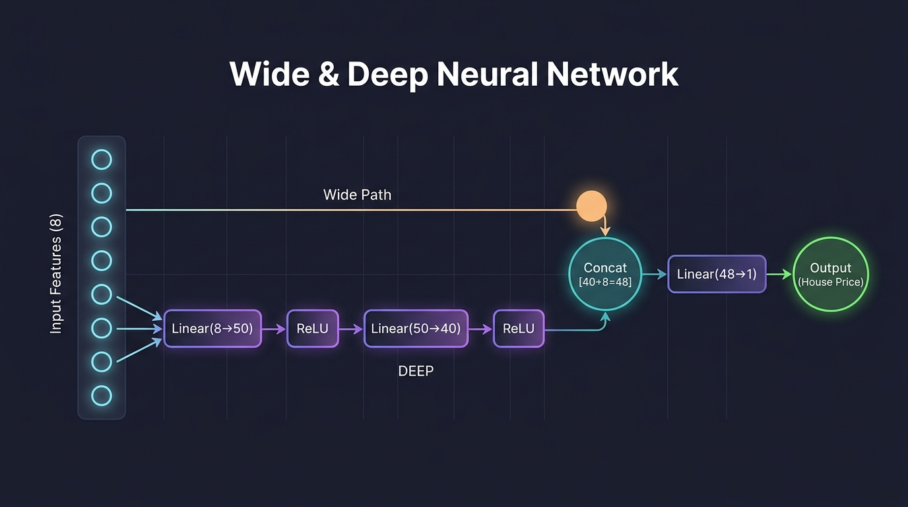

# 🏠 Wide & Deep Neural Network – California Housing

A **Wide & Deep** regression network built in **PyTorch** to predict median house values from the **California Housing** dataset.

The idea (from Google's 2016 *Wide & Deep Learning* paper): the input goes through a deep MLP **and** is also sent straight to the output layer. The deep path learns complex patterns, while the wide path keeps simple, direct relationships from the raw features.



## 🧠 Model

```python
class WideAndDeep(nn.Module):
    def __init__(self, n_features):
        super().__init__()
        self.deep_stack = nn.Sequential(
            nn.Linear(n_features, 50), nn.ReLU(),
            nn.Linear(50, 40),        nn.ReLU(),
        )
        self.output_layer = nn.Linear(40 + n_features, 1)

    def forward(self, X):
        deep_output = self.deep_stack(X)
        wide_n_deep = torch.cat([X, deep_output], dim=1)   # wide + deep
        return self.output_layer(wide_n_deep)
```

```
          ┌──────────── wide path (8 raw features) ─────────────┐
Input (8) ┤                                                      ├─ concat (48) → Linear → price
          └─ Linear(8,50) → ReLU → Linear(50,40) → ReLU (deep) ─┘
```

## ⚙️ Training setup

| Setting | Value |
|---------|-------|
| Dataset | California Housing (scikit-learn), 8 features |
| Split | 72% train / 8% validation / 20% test |
| Scaling | `StandardScaler` |
| Loss | MSE |
| Optimizer | Adam, lr = 1e-3 |
| LR schedule | `StepLR` (halve every 30 epochs) |
| Batch size | 256 |
| Epochs | 100 |

## 📊 Results (test set)

| Metric | Value |
|--------|-------|
| R² | **0.766** |
| RMSE | **0.5534** (in units of $100k) |


The vertical line of points at 5.0 comes from the dataset itself – house values are capped at $500k.

## 📁 Files

| File | Description |
|------|-------------|
| `widendep.ipynb` | The notebook: model, data prep, training, evaluation |
| `wide_deep_architecture_*.jpg` | Architecture diagram |
| `Pasted image.png` | Loss curves, predicted-vs-actual plot, residuals histogram |
| `2026-09-30_00-50.png` | Screenshot of the notebook in VS Code |

## ▶️ Run it

```bash
git clone https://github.com/Adarshmilan/wideanddeepnn.git
cd wideanddeepnn
pip install torch numpy pandas matplotlib scikit-learn jupyter
jupyter notebook widendep.ipynb
```

Uses the GPU automatically if CUDA is available.
